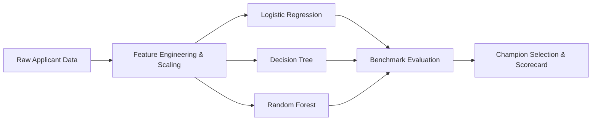

# 💳 Credit Scoring & Risk Prediction Model
> **CodeAlpha Machine Learning Internship Project**  
> An end-to-end Machine Learning and Credit Bureau Underwriting System that predicts an individual's creditworthiness and default probability using past financial history.

---

## 📌 1. Project Overview (What is this project?)

When you apply for a credit card, personal loan, or mortgage, the bank needs to answer one fundamental question:
> **"If we lend this person money, what is the chance they will pay us back on time versus defaulting (failing to repay)?"**

Traditionally, human loan officers reviewed paper files. Today, banks use **Supervised Classification Algorithms** and **Credit Scoring Models** to automate this decision accurately in seconds.

### 🎯 Core Objectives:
1. **Predict Creditworthiness:** Classify loan applicants into **Good Credit (Non-Defaulter, 0)** or **High Risk (Defaulter, 1)**.
2. **Financial Feature Engineering:** Derive industry-standard risk ratios such as **Debt-to-Income (DTI)**, **Credit Utilization**, and **Loan-to-Income (LTI)**.
3. **Compare Machine Learning Classifiers:** Benchmark **Logistic Regression**, **Decision Trees**, and **Random Forest**.
4. **Rigorous Accuracy Assessment:** Evaluate models using **Precision, Recall, F1-Score, and ROC-AUC**.
5. **Credit Scorecard Generation:** Convert default probability into an industry-standard **300 to 850 Credit Score** (like FICO / CIBIL / Experian).
6. **Interactive Web Dashboard:** Provide an intuitive Streamlit UI where loan officers and applicants can test scenarios in real time.

---

## 🗂️ 2. Project Architecture & File Structure

```
CodeAlpha_CreditScoringModel/
│
├── data/
│   ├── generate_data.py          # Script generating 7,500 realistic banking records
│   └── credit_data.csv           # Financial dataset (Income, Debts, History, etc.)
│
├── src/
│   ├── __init__.py
│   ├── feature_engineering.py    # Ratios (DTI, Utilization, LTI), Scaling & Encoding
│   ├── model_training.py         # Model training & automated champion selection
│   ├── evaluation.py             # Metrics computation (Precision, Recall, F1, ROC-AUC)
│   └── scorecard.py              # Translates default probability to 300-850 credit score
│
├── models/                       # Persisted trained models & transformers
│   ├── best_model.pkl            # Champion model file
│   ├── preprocessor.pkl          # Scikit-Learn transformer (OneHotEncoder + StandardScaler)
│   ├── all_models.pkl            # All 3 trained models
│   └── model_metadata.json       # Metrics and training parameters
│
├── visualizations/               # Saved high-resolution charts
│   ├── roc_curves.png            # ROC Curves comparison
│   ├── confusion_matrices.png    # Confusion Matrices for all 3 algorithms
│   ├── model_comparison.png      # Bar chart comparing all metrics
│   └── feature_importance.png    # Top financial drivers identified by Random Forest
│
├── app.py                        # Interactive Streamlit Web Application
├── predict.py                    # Command-line prediction tool for individual applicants
├── main.py                       # Single command to train, evaluate, and save everything
├── requirements.txt              # Required Python packages
└── README.md                     # Comprehensive project documentation
```

---

## 📊 3. The Dataset Explained in Simple Words

The dataset contains **7,500 realistic customer profiles** with 15 core financial attributes:

| Column Name | Meaning in Plain English | Why it matters to Lenders |
| :--- | :--- | :--- |
| `person_age` | Applicant's age in years | Stability and life stage indicator |
| `person_income` | Annual gross income ($) | High income provides capacity to absorb unexpected shocks |
| `person_home_ownership` | RENT, MORTGAGE, OWN, OTHER | Homeowners represent lower flight risk and higher stability |
| `person_emp_length` | Years at current employer | Job stability correlates with steady income |
| `loan_intent` | Purpose: Education, Medical, Debt Consolidation, etc. | Identifies why funds are needed |
| `loan_amnt` | Amount of loan requested ($) | Size of exposure |
| `loan_int_rate` | Interest rate charged (%) | Risk-based pricing |
| `cb_person_cred_hist_length`| Number of years borrower has used credit | Longer credit history gives more data on habits |
| `total_credit_limit` | Sum of limits on credit cards & credit lines | Available credit capacity |
| `total_credit_used` | Current balance owed across all credit lines | Current debt burden |
| `existing_loans_count` | Number of open active loans | Multiple open loans indicate higher payment burden |
| `cb_person_delinquencies` | Times borrower was 30+ days late on payments | **Strongest warning sign** of future default |
| `cb_person_bankruptcies` | Past legal bankruptcies | Legal record of non-payment |
| `loan_status` (**Target**) | **0 = Paid on time**, **1 = Defaulted** | What our Machine Learning models learn to predict |

---

## 🧠 4. Feature Engineering: Turning Raw Data into Financial Signals

Raw data alone doesn't tell the full story. For instance, a \$10,000 loan is tiny for someone earning \$200,000, but catastrophic for someone earning \$18,000!

We engineered **7 powerful domain-specific financial indicators**:

### 1. Loan-to-Income (LTI)
$$\text{LTI} = \frac{\text{Loan Amount}}{\text{Annual Income}}$$
- **Meaning:** How big is the loan compared to what you make in a year?
- **Rule of thumb:** LTI above 35% indicates high financial strain.

### 2. Credit Utilization Ratio
$$\text{Credit Utilization} = \frac{\text{Total Credit Used}}{\text{Total Credit Limit}}$$
- **Meaning:** What percentage of your credit card limit are you maxing out?
- **FICO Rule:** Below 30% is great; above 70% shows you might be living on borrowed money.

### 3. Estimated Debt-to-Income (DTI)
$$\text{DTI} = \frac{\text{Estimated Monthly Loan Payment} + \text{Existing Debt Minimum}}{\text{Monthly Gross Income}}$$
- **Meaning:** What percentage of monthly income is swallowed by debt payments?
- **Banking Standard:** Underwriters prefer DTI under 36%; above 43% often triggers rejection.

### 4. Delinquency-to-Loans Ratio
$$\text{Delinquency Ratio} = \frac{\text{Past Delinquencies}}{\text{Total Existing Loans}}$$
- **Meaning:** Normalizes missed payments by how many accounts the borrower manages.

### 5. Credit History to Adult Age Ratio
$$\text{Credit Age Ratio} = \frac{\text{Credit History Length}}{\text{Age} - 18}$$
- **Meaning:** What portion of adult life has this borrower spent building credit?

### 6. Emergency Available Credit Buffer
$$\text{Available Credit} = \text{Total Credit Limit} - \text{Total Credit Used}$$
- **Meaning:** Unused credit line available if an unexpected emergency strikes.

### 7. Risk Flags Count (0 to 4)
- A composite warning flag counting: high utilization (>60%), high LTI (>30%), past delinquencies (>0), and past bankruptcy (>0).

---

## 🤖 5. Machine Learning Classification Algorithms

We implement and compare 3 foundational classification algorithms:



### 1. Logistic Regression (The Banking Benchmark)
- **How it works:** Uses the Sigmoid ($\sigma$) mathematical function to calculate a probability between 0 and 1:
  $$P(\text{Default}) = \frac{1}{1 + e^{-(\beta_0 + \beta_1 X_1 + \dots + \beta_k X_k)}}$$
- **Why banks love it:** It is **interpretable**. Every coefficient directly shows how much a unit increase in debt increases the log-odds of default. Required by many financial regulators.

### 2. Decision Tree Classifier
- **How it works:** Splits the data through a series of IF-THEN questions (e.g., *"Is Credit Utilization > 65%?"* $\rightarrow$ YES $\rightarrow$ *"Has borrower defaulted before?"*).
- **Pros:** Extremely transparent and easy to explain to non-technical loan officers.
- **Cons:** Prone to overfitting if tree depth is not controlled.

### 3. Random Forest Classifier
- **How it works:** An **Ensemble method** that grows 150 independent decision trees on random subsets of data and features, then averages their votes ("Wisdom of the Crowd").
- **Pros:** Highly accurate, handles non-linear interactions effortlessly, resilient to outliers.

---

## 📏 6. Evaluation Metrics: Why Accuracy is NOT Enough!

In credit risk, evaluating models with simple **Accuracy** can lead to financial disaster!

### Why? The Imbalance Trap:
Suppose a bank has 10,000 loans, and only 500 people default (5%).
A lazy model that says **"Nobody will ever default"** will achieve **95% Accuracy**!
However, that model caught **0 defaulters**, and the bank loses millions of dollars!

### The Metrics That Really Matter:

1. **Recall (Sensitivity):**
   $$\text{Recall} = \frac{\text{True Defaulters Caught}}{\text{All Actual Defaulters}}$$
   - *In Plain English:* Out of everyone who actually defaulted, what percentage did our model stop?
   - In banking, **High Recall is critical** to prevent bad debts.

2. **Precision:**
   $$\text{Precision} = \frac{\text{True Defaulters Caught}}{\text{All People Flagged as Defaulters}}$$
   - *In Plain English:* When the model flags someone as high risk, how often is it right?
   - Protects the bank from wrongly rejecting good, paying customers.

3. **F1-Score:**
   $$\text{F1} = 2 \times \frac{\text{Precision} \times \text{Recall}}{\text{Precision} + \text{Recall}}$$
   - Harmonic mean balancing Precision and Recall.

4. **ROC-AUC (Receiver Operating Characteristic - Area Under Curve):**
   - Measures how well the model separates good borrowers from bad borrowers across every possible threshold (from 0.0 to 1.0).
   - An AUC of `0.50` is a random coin toss; an AUC above `0.80` represents strong discrimination power.

### 🏆 Model Comparison Results on Test Set:

| Algorithm | Accuracy | Precision | Recall | F1-Score | ROC-AUC | Status |
| :--- | :---: | :---: | :---: | :---: | :---: | :---: |
| **Logistic Regression** | **74.93%** | 65.56% | **76.65%** | **70.67%** | **0.8384** | 🥇 **Champion** |
| **Random Forest** | **75.07%** | **67.30%** | 71.40% | 69.29% | 0.8180 | 🥈 Runner-up |
| **Decision Tree** | 70.53% | 60.33% | 73.60% | 66.31% | 0.7736 | 🥉 Baseline |

> **Key Takeaway:** Logistic Regression achieved the highest ROC-AUC (0.8384) and highest Recall (76.65%), making it the best model for minimizing credit default risk.

---

## 🎯 7. The 300 to 850 Credit Scorecard Conversion

Loan officers don't tell customers: *"You have a 0.0435 probability of default."*  
Instead, they provide a standard **Credit Score (300 to 850)**!

We implement the standard **Points to Double the Odds (PDO)** methodology used by credit bureaus:
$$\text{Odds} = \frac{1 - P(\text{Default})}{P(\text{Default})}$$
$$\text{Credit Score} = \text{Offset} + \text{Factor} \times \ln(\text{Odds})$$

### Scorecard Risk Tiers:
- **750 - 850 (Exceptional):** Very low risk $\rightarrow$ **Instant Approval** at lowest interest rates.
- **700 - 749 (Good):** Low risk $\rightarrow$ **Approved** at standard market rates.
- **640 - 699 (Fair):** Moderate risk $\rightarrow$ **Manual Review / Income Verification Required**.
- **580 - 639 (Poor):** High risk $\rightarrow$ **High APR / Collateral Required**.
- **300 - 579 (Very Poor):** Extreme risk $\rightarrow$ **Application Declined**.

---

## 🚀 8. Quickstart Guide (How to Run the Project)

### Step 1: Install Dependencies
Open your command terminal (PowerShell or Bash) and run:
```bash
pip install -r requirements.txt
```

### Step 2: Run the Complete Pipeline (1-Click)
```bash
python main.py
```
This single command will:
1. Verify or generate the dataset (`data/credit_data.csv`).
2. Run feature engineering.
3. Train Logistic Regression, Decision Trees, and Random Forest.
4. Evaluate all metrics on the test set.
5. Generate and save high-res ROC curves, confusion matrices, and feature importance charts in `visualizations/`.
6. Serialize the champion model into `models/best_model.pkl`.

### Step 3: Test a Single Applicant on the Command Line
```bash
python predict.py
```
Outputs instant credit scores, risk tiers, and ratio breakdowns for sample prime and subprime borrowers.

### Step 4: Launch the Interactive Streamlit Web App
```bash
streamlit run app.py
```
Opens an interactive dashboard in your web browser (`http://localhost:8501`) where you can adjust applicant sliders, load presets, and view instant credit decisions and charts!

---

## 📈 9. Visualizations Generated

All evaluation figures are automatically generated and saved in the `visualizations/` folder:
- **`roc_curves.png`**: ROC curves comparing all 3 classifiers.
- **`confusion_matrices.png`**: Heatmaps showing True Positives, True Negatives, False Positives, and False Negatives.
- **`model_comparison.png`**: Multi-metric bar chart comparing Accuracy, Precision, Recall, F1, and ROC-AUC.
- **`feature_importance.png`**: Ranked importance chart showing top financial drivers (Credit Utilization, Loan-to-Income, Delinquencies).

---

## 💡 10. Frequently Asked Questions (Interview Prep)

<details>
<summary><b>Q1: What is the biggest difference between Credit Scoring and other classification tasks?</b></summary>
In credit scoring, errors have asymmetrical financial costs. A <b>False Negative</b> (approving someone who defaults) costs the bank the entire remaining principal balance. A <b>False Positive</b> (declining someone who would have paid) only costs the missed interest revenue. Therefore, credit models prioritize higher <b>Recall</b> and <b>ROC-AUC</b> over raw accuracy.
</details>

<details>
<summary><b>Q2: Why did we scale features with StandardScaler?</b></summary>
Logistic Regression optimizes weights using gradient descent and L2 regularization. If income is in tens of thousands (\$80,000) while delinquencies are small numbers (0 to 3), the unscaled income will dominate the weights regardless of importance. StandardScaler normalizes all features to mean 0 and standard deviation 1.
</details>

<details>
<summary><b>Q3: How do you prevent Data Leakage in Feature Engineering?</b></summary>
All transformations (scaling parameters, mean/median imputers, one-hot encodings) are strictly fitted on the <b>Training set</b> (80%) and only used to transform the <b>Testing set</b> (20%). Never fit transformers on the full dataset before splitting!
</details>

---

## 👨‍💻 Author
- **Project:** Credit Scoring Model
- **Internship:** CodeAlpha Data Science & Machine Learning Internship
- **Environment:** Python 3.11, Scikit-Learn, Pandas, NumPy, Streamlit, Seaborn, Matplotlib
